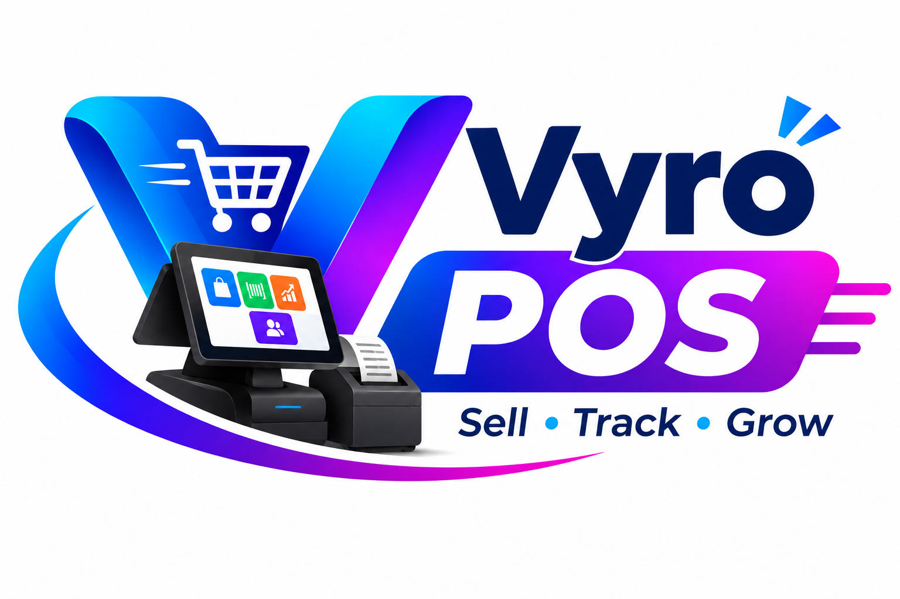

# Vyro POS - Modern Retail Management System

A comprehensive Point of Sale (POS) system built with React, Vite, and Supabase. Features multi-store management, subscription billing, inventory tracking, sales analytics, and more.



## 🚀 Features

### Core POS Features
- **✨ Modern POS Interface** - Fast, intuitive checkout experience
- **📦 Inventory Management** - Real-time stock tracking with low-stock alerts
- **👥 Customer Management** - Loyalty points, purchase history, contact management
- **📊 Sales Analytics** - Real-time dashboards, charts, and reports
- **🏪 Multi-Store Support** - Manage multiple retail locations from one system
- **💳 Payment Methods** - M-Pesa, Cash, Card support
- **🔍 Barcode Scanner** - Built-in camera barcode/QR scanning

### Advanced Features
- **🔐 Role-Based Access** - Super Admin, Manager, and Cashier roles
- **💰 Subscription Management** - Tiered plans (Trial, Basic, Premium)
- **📱 WhatsApp Integration** - Share credentials and reminders
- **📈 Business Intelligence** - Sales trends, revenue analytics, customer insights
- **🧾 Receipt Printing** - Print or share digital receipts
- **📮 Activity Logs** - Comprehensive audit trail
- **🌐 Offline Support** - LocalStorage fallback when offline
- **📱 Mobile Responsive** - Works on phones, tablets, and desktops

### Manager Tools
- **👤 Staff Management** - Add/remove cashiers, password resets
- **🎨 Store Settings** - Customize branding, tax rates, loyalty programs
- **📊 Store Reports** - Performance metrics and insights
- **💳 Subscription Renewal** - Self-service subscription management

### Admin Portal
- **🏢 Store Management** - Create, suspend, and manage stores
- **👥 User Management** - Cross-store user administration
- **💳 Payment Processing** - Approve/reject subscription payments
- **📊 Revenue Dashboard** - System-wide analytics
- **📝 Subscription Requests** - Review and approve new store applications

---

## 📋 Prerequisites

- **Node.js** v18 or higher
- **npm** or **yarn**
- **Supabase Account** (free tier available)
- **Modern Browser** (Chrome, Firefox, Safari, Edge)

---

## 🛠️ Installation

### 1. Clone the Repository
```bash
git clone https://github.com/YOUR-USERNAME/vyro-pos.git
cd vyro-pos
```

### 2. Install Dependencies
```bash
npm install
```

### 3. Set Up Environment Variables
Create a `.env` file in the root directory:

```bash
VITE_SUPABASE_URL=https://your-project-id.supabase.co
VITE_SUPABASE_ANON_KEY=your-anon-public-key-here
```

Get these from your Supabase project:
- Dashboard → Settings → API

### 4. Set Up Database
Run the SQL migrations in Supabase SQL Editor **in this order**:

1. `supabase/schema.sql` - Base tables
2. `supabase/add_subscriptions.sql` - Subscription system
3. `supabase/add_subscription_requests.sql` - Request management
4. `supabase/add_payment_approval.sql` - Payment processing
5. `supabase/add_email_auth.sql` - Email/password authentication

### 5. Start Development Server
```bash
npm run dev
```

Open [http://localhost:5173](http://localhost:5173)

---

## 🔑 Default Login

After running migrations, login as super admin:
- **Email:** `admin@vyrosocial.com`
- **Password:** `Hussein@4`

⚠️ **Change these credentials immediately after first login!**

---

## 📦 Building for Production

```bash
npm run build
```

This creates an optimized build in the `dist/` folder ready for deployment.

Test the production build locally:
```bash
npm run preview
```

---

## 🚀 Deployment

### Quick Deploy to Vercel (Recommended)

[](https://vercel.com/new)

1. Connect your GitHub repository
2. Add environment variables:
   - `VITE_SUPABASE_URL`
   - `VITE_SUPABASE_ANON_KEY`
3. Deploy!

### Quick Deploy to Netlify

[](https://app.netlify.com/start)

1. Connect your GitHub repository
2. Build command: `npm run build`
3. Publish directory: `dist`
4. Add environment variables
5. Deploy!

### Manual Deployment

See [DEPLOYMENT.md](DEPLOYMENT.md) for detailed deployment instructions including:
- Vercel
- Netlify
- Custom server (Nginx/Apache)
- Environment configuration
- Post-deployment checklist

---

## 📁 Project Structure

```
vyro-pos/
├── src/
│   ├── main.jsx              # Main app component
│   ├── supabase.js           # Supabase client & API functions
│   ├── BarcodeScanner.jsx    # Barcode scanning component
│   ├── Charts.jsx            # Chart components
│   ├── PublicSite.jsx        # Landing page
│   ├── styles.css            # Global styles
│   ├── public-site.css       # Landing page styles
│   └── logo.png              # Logo asset
├── supabase/
│   ├── schema.sql            # Base database schema
│   ├── add_subscriptions.sql # Subscription tables & functions
│   ├── add_subscription_requests.sql
│   ├── add_payment_approval.sql
│   └── add_email_auth.sql    # Auth migration (PIN → Email)
├── public/
│   └── logo.png              # Public logo
├── dist/                     # Production build (generated)
├── index.html                # Entry HTML
├── vite.config.js            # Vite configuration
├── package.json              # Dependencies
├── .env                      # Environment variables (create this)
├── .env.example              # Environment template
├── vercel.json               # Vercel config
├── netlify.toml              # Netlify config
├── .gitignore                # Git ignore rules
├── DEPLOYMENT.md             # Deployment guide
└── README.md                 # This file
```

---

## 🔧 Configuration

### Subscription Plans

Configure in Admin Portal → Subscriptions or directly in Supabase `subscription_plans` table:

| Plan | Duration | Price | Cashiers |
|---|---|---|---|
| Trial | 7 days | Free | 3 |
| Monthly Basic | 30 days | Custom | 5 |
| Monthly Premium | 30 days | Custom | 10 |
| Yearly Basic | 365 days | Custom | 5 |
| Yearly Premium | 365 days | Custom | Unlimited |

### Payment Configuration

Set up M-Pesa payment details in Admin Portal → Settings → Payment Configuration:
- Business Number (Paybill/Till)
- Account Number (optional)
- Business Name
- Payment Instructions

---

## 🧪 Testing

### Test a Complete Flow

1. **Login as Super Admin**
   - Email: `admin@vyrosocial.com`
   - Password: `Hussein@4`

2. **Create a Test Store**
   - Go to Stores → + New Store
   - Fill in details
   - Share credentials via WhatsApp or copy

3. **Login as Manager**
   - Use the generated credentials
   - Add products and categories
   - Add a staff member (cashier)

4. **Login as Cashier**
   - Process a test sale
   - Try barcode scanning
   - Add customer loyalty points

5. **Verify Everything**
   - Check sales appear in reports
   - Verify inventory updated
   - Check activity logs

---

## 🎨 Customization

### Branding
- Update `public/logo.png` with your logo
- Modify colors in `src/styles.css` (`:root` variables)
- Update store name in Settings

### Features
- Enable/disable features by modifying role permissions in `src/main.jsx`
- Customize loyalty point rates in store settings
- Adjust subscription plans in database

---

## 🔒 Security

### Best Practices
- ✅ Row Level Security (RLS) enabled on all tables
- ✅ Secure password hashing (bcrypt)
- ✅ Role-based access control
- ✅ API keys in environment variables (not committed)
- ✅ HTTPS enforced in production
- ✅ Input validation on all forms

### Recommendations
- Change default admin password immediately
- Use strong passwords (min 6 characters, mixed case, numbers)
- Enable Supabase Auth email verification
- Regular database backups
- Monitor activity logs for suspicious activity

---

## 📱 Browser Support

| Browser | Version |
|---|---|
| Chrome | Last 2 versions ✅ |
| Firefox | Last 2 versions ✅ |
| Safari | Last 2 versions ✅ |
| Edge | Last 2 versions ✅ |
| Mobile Safari (iOS) | iOS 14+ ✅ |
| Chrome (Android) | Android 8+ ✅ |

**Note:** Barcode scanning requires camera access and works best in Chrome/Edge.

---

## 🐛 Troubleshooting

### "Supabase not configured"
- Verify `.env` file exists with correct credentials
- Check Supabase project is active
- Restart dev server after changing `.env`

### Login not working
- Verify SQL migrations ran successfully
- Check super admin user exists in `pos_users` table
- Try password reset in Supabase dashboard

### Products not showing
- Check RLS policies in Supabase
- Verify store_id is set correctly
- Check browser console for errors

### Barcode scanner not working
- Allow camera permissions in browser
- Use HTTPS (required for camera access)
- Try manual barcode entry as fallback

### 404 on page refresh
- Check deployment routing is configured for SPA
- See `vercel.json` or `netlify.toml` for examples

---

## 🤝 Contributing

Contributions are welcome! Please:

1. Fork the repository
2. Create a feature branch (`git checkout -b feature/amazing-feature`)
3. Commit your changes (`git commit -m 'Add amazing feature'`)
4. Push to the branch (`git push origin feature/amazing-feature`)
5. Open a Pull Request

---

## 📄 License

This project is licensed under the MIT License - see the [LICENSE](LICENSE) file for details.

---

## 🙏 Acknowledgments

- Built with [Vite](https://vitejs.dev/)
- Database by [Supabase](https://supabase.com/)
- Icons from [Unicode Emoji](https://unicode.org/emoji/)
- Charts with vanilla JS (custom implementation)

---

## 📞 Support

For issues and questions:
- 📖 Check [DEPLOYMENT.md](DEPLOYMENT.md)
- 🐛 Open an issue on GitHub
- 📧 Contact: support@vyropos.com

---

## 🗺️ Roadmap

- [ ] Dark mode support
- [ ] Multi-currency support
- [ ] Advanced reporting (PDF export)
- [ ] Email notifications
- [ ] SMS integration
- [ ] Offline PWA mode
- [ ] Mobile apps (iOS/Android)
- [ ] API for third-party integrations

---

**Built with ❤️ for modern retail businesses**
